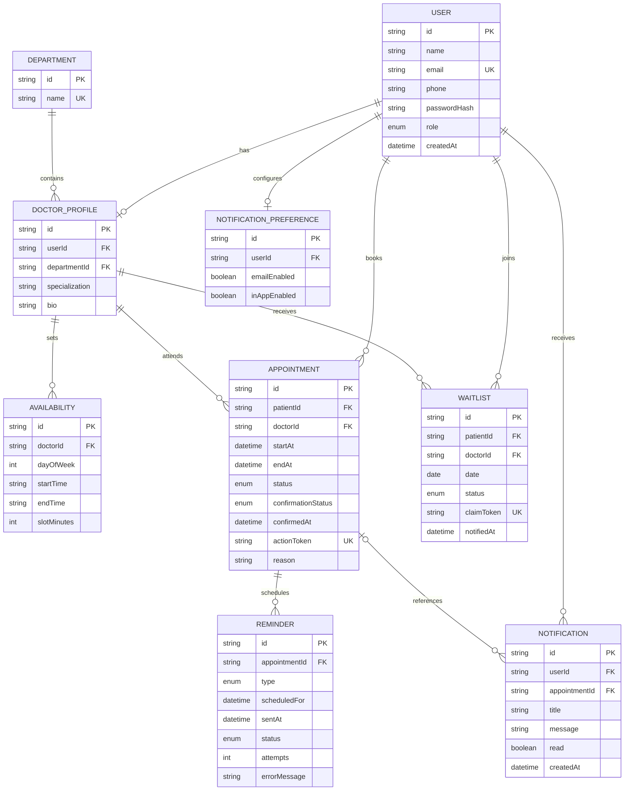

# Database Entity Relationship Diagram

The appointment table has an index on doctor and start time and a partial unique database index for active appointments. That index excludes rows with `CANCELLED` status, allowing a freed time to be booked again while preventing concurrent active bookings. The partial index is added in the SQL migration because Prisma schema syntax cannot express its predicate directly.
