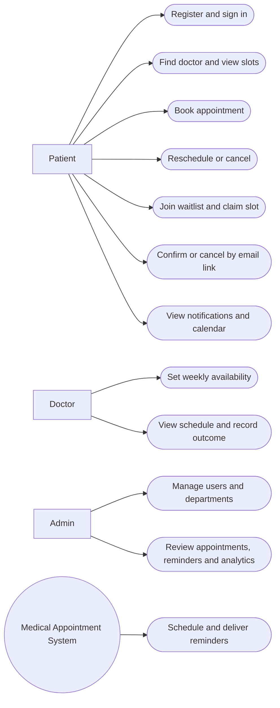
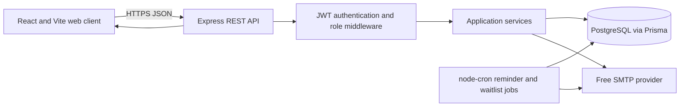
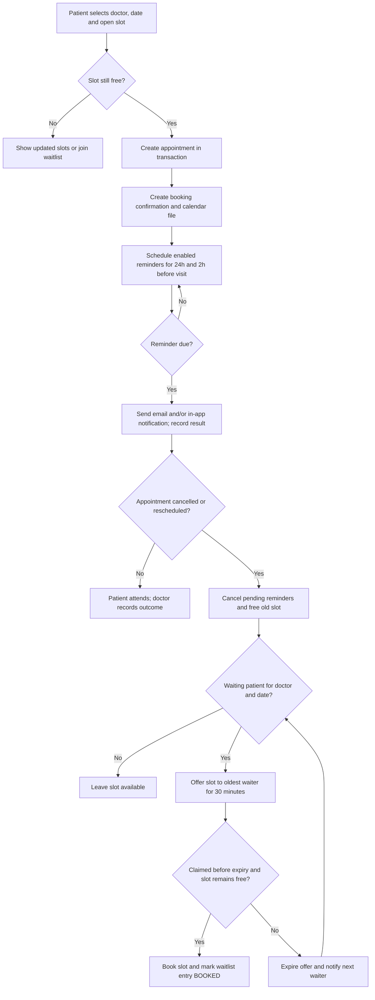

# System Requirements and Design

## Purpose and scope

This document defines the first version of the Medical Appointment Scheduling System with Automated Reminders. Patients can find doctors, book and manage appointments, and receive email and in-app reminders. Doctors manage their weekly availability and appointment outcomes. Administrators manage users and review appointment and reminder activity. The system supports a waitlist, secure email actions, calendar files, and no-show analytics. SMS and paid services are outside the current scope.

## Functional requirements

### Patient

1. The system shall allow a patient to register with a name, email address, phone number, and password.
2. The system shall allow registered users to sign in and sign out.
3. The system shall allow an authenticated patient to view and update their name, phone number, and notification preferences.
4. The system shall allow a patient to search doctors by name.
5. The system shall allow a patient to filter doctors by department.
6. The system shall show a doctor's specialization, department, biography, and available appointment slots.
7. The system shall show only future, unbooked slots that fall within the doctor's availability.
8. The system shall allow a patient to book an available slot and optionally enter an appointment reason.
9. The system shall prevent a patient from booking a slot that another request has already claimed.
10. The system shall allow a patient to view their upcoming and past appointments.
11. The system shall allow a patient to reschedule their appointment at least two hours before its start time.
12. The system shall allow a patient to cancel their appointment at least two hours before its start time.
13. The system shall allow a patient to join the waitlist for a doctor and date when no suitable slot is available.
14. The system shall allow a patient to withdraw from their own waitlist entry.
15. The system shall notify a patient when a waitlisted slot becomes available and provide a time-limited claim link.
16. The system shall allow the patient who received a waitlist offer to claim the offered slot while it remains available and the claim link is valid.
17. The system shall allow a patient to view their notifications and mark one or all notifications as read.
18. The system shall allow a patient to download an ICS calendar file for an appointment they own.
19. The system shall allow a patient to confirm or cancel an appointment through a secure email link without signing in.

### Doctor

20. The system shall allow an authenticated doctor to set weekly working days, start and end times, and slot duration.
21. The system shall allow a doctor to view their appointment schedule for a selected date.
22. The system shall show the patient's name, appointment time, reason when provided, and current status on the doctor's schedule.
23. The system shall allow a doctor to mark their own appointment as completed or no-show.
24. The system shall notify a doctor when a patient confirms or cancels through an email action link.

### Administrator

25. The system shall allow an administrator to create a doctor account and assign a department and profile.
26. The system shall allow an administrator to view, search, and deactivate user accounts.
27. The system shall allow an administrator to view appointments with date, doctor, status, and patient filters and pagination.
28. The system shall allow an administrator to manage departments and doctor assignments.
29. The system shall allow an administrator to view reminder records, delivery status, attempts, and errors.
30. The system shall allow an administrator to view appointment totals, cancellation and no-show rates, and comparisons by patient confirmation status.
31. The system shall allow an administrator to view appointment patterns by weekday, hour, doctor, and department.
32. The system shall allow an administrator to view the waitlist slot fill rate and export analytics data as CSV.

### System and notifications

33. The system shall create an in-app notification and attempt an email booking confirmation after a booking succeeds.
34. The system shall schedule email and in-app reminders 24 hours and two hours before an appointment when those times are still in the future and the patient has enabled the relevant channel.
35. The system shall send due reminders using a background scheduler and record whether each attempt succeeded or failed.
36. The system shall retry failed reminders no more than three times and avoid sending the same reminder more than once after a successful send.
37. The system shall cancel pending reminders when an appointment is cancelled or rescheduled.
38. The system shall include a calendar attachment in booking confirmation messages and an updated calendar file after rescheduling or cancellation.
39. The system shall offer a newly freed appointment slot to the oldest eligible waitlist entry for the same doctor and date.
40. The system shall expire unclaimed waitlist offers after 30 minutes and continue to the next eligible entry.
41. The system shall expose a health endpoint for local and deployment monitoring.

## Non-functional requirements

1. **Security:** Passwords shall be stored using bcrypt hashes. Authenticated endpoints shall verify a signed, expiring JWT and enforce role and record ownership. Public appointment-action tokens shall be cryptographically random, rate-limited, and limited to a safe appointment summary.
2. **Privacy:** Patients shall only access their own profile, appointments, notifications, waitlist entries, and calendar files. API responses and logs shall not expose password hashes or another patient's private data.
3. **Input handling:** The API shall validate and normalize user input, return consistent errors, and set secure HTTP headers. Database access shall use Prisma's parameterized queries.
4. **Reliability:** Reminder processing shall recover pending work after a restart, record failures, and use idempotent state transitions. Appointment booking shall use a transaction or database constraint to prevent double booking.
5. **Performance:** Common doctor searches, slot lookups, appointment lists, and dashboards should return within two seconds under the expected demonstration workload. List endpoints shall paginate potentially large results.
6. **Usability:** The interface shall use clear labels, validation messages, loading states, empty states, and confirmation for consequential actions. Core patient tasks shall work on narrow mobile screens and desktop browsers.
7. **Accessibility:** Forms shall have programmatic labels, keyboard-operable controls, visible focus, sufficient color contrast, and meaningful status text.
8. **Availability:** Local development shall run without paid services. Deployment shall use the free tiers named in the project brief; their limits and terms can change.
9. **Maintainability:** The API shall separate routes, controllers, services, middleware, jobs, and utilities. Shared UI components and documented environment variables shall be used.
10. **Compatibility:** The web client shall support current versions of major desktop and mobile browsers. Calendar files shall use the interoperable ICS format.
11. **Observability:** The application shall record structured operational errors and reminder outcomes without logging passwords, JWTs, action tokens, or sensitive appointment reasons unnecessarily.
12. **Cost constraint:** The intended configuration shall not depend on a paid API, subscription, or SMS provider. Email delivery may use a free SMTP option configured by the operator; delivery limits are provider-controlled.

## User stories and acceptance criteria

1. **Patient registration** — As a patient, I want to create an account so that I can manage my appointments. **Acceptance:** valid details create a patient account; duplicate email and invalid password receive clear errors; the password is never returned or stored in plain text.
2. **Patient sign-in** — As a patient, I want to sign in so that I can access my private schedule. **Acceptance:** valid credentials return a one-day JWT and safe user details; invalid credentials return a generic authentication error.
3. **Find a doctor** — As a patient, I want to search doctors by name and department so that I can find appropriate care. **Acceptance:** search and department filters can be combined; results show doctor profile and department.
4. **View available slots** — As a patient, I want to see open future times so that I can choose a convenient appointment. **Acceptance:** past times, unavailable periods, and non-cancelled bookings are excluded.
5. **Book an appointment** — As a patient, I want to book an open slot so that I can reserve a visit. **Acceptance:** a successful booking is confirmed and creates a confirmation notification; a competing booking for the same doctor and start time is rejected.
6. **Review appointments** — As a patient, I want separate upcoming and past appointment lists so that I can track my care. **Acceptance:** only the signed-in patient's records appear and status/date filters work.
7. **Reschedule** — As a patient, I want to move an appointment so that I can adapt when plans change. **Acceptance:** a free future slot is required; changes less than two hours before the original appointment are rejected; pending reminders are replaced.
8. **Cancel** — As a patient, I want to cancel in advance so that someone else can use the slot. **Acceptance:** cancellation is rejected inside the two-hour limit; successful cancellation frees the slot and invokes the waitlist offer process.
9. **Join a waitlist** — As a patient, I want to join a doctor's waitlist for a date so that I may take a slot if one opens. **Acceptance:** the entry is associated with the selected doctor and date; duplicate active entries are prevented or clearly handled.
10. **Claim a freed slot** — As a waitlisted patient, I want a short-lived offer when a slot opens so that I can book it promptly. **Acceptance:** the oldest eligible entry receives the offer; only that patient can claim it; expired, reused, or already-booked claims fail safely.
11. **Confirm by email** — As a patient, I want to confirm without signing in so that I can respond quickly. **Acceptance:** a valid POST action records confirmation time and status; a GET request only displays a safe summary and makes no change.
12. **Receive reminders** — As a patient, I want email and in-app reminders before a visit so that I remember to attend. **Acceptance:** enabled channels are scheduled for 24 hours and two hours before the visit; past reminder times are skipped; delivery results are recorded.
13. **Manage availability** — As a doctor, I want to set my working days and hours so that patients can book suitable times. **Acceptance:** saved recurring availability drives future slot generation and invalid time ranges are rejected.
14. **Record visit outcome** — As a doctor, I want to mark my appointments completed or no-show so that records stay current. **Acceptance:** a doctor can update only their own appointments and only to allowed outcome statuses.
15. **Review service performance** — As an administrator, I want to compare no-show rates for confirmed and unconfirmed appointments so that I can evaluate reminders. **Acceptance:** the selected date range is applied; totals and rates use the same appointment population; empty groups return zero or null safely and are labelled.

## Use case descriptions

| Use case | Primary actor | Preconditions | Main outcome |
|---|---|---|---|
| Register | Patient | Email is not already registered | Patient account is created |
| Login | Patient, Doctor, Admin | Account is active | JWT and safe profile are returned |
| Book Appointment | Patient | Authenticated; slot is future and free | Appointment is confirmed and notifications are queued |
| Reschedule | Patient | Own appointment; at least two hours remain | Appointment moves to a free slot and reminders are replaced |
| Cancel | Patient | Own appointment; at least two hours remain | Appointment is cancelled and its slot is offered to the waitlist |
| Join Waitlist | Patient | Authenticated; requested date has no suitable free slot | Active waitlist entry is created |
| Claim Freed Slot | Patient | Matching valid offer belongs to patient; slot remains free | Appointment is created and waitlist entry becomes booked |
| Confirm or Cancel via Email Link | Patient | Valid action token; appointment has not started | Appointment action is recorded without login |
| Set Availability | Doctor | Authenticated as doctor | Weekly availability is saved |
| Manage Doctors | Admin | Authenticated as admin | Doctor accounts and department assignments are maintained |
| View No-show Analytics | Admin | Authenticated as admin | Aggregated counts and rates are displayed for a date range |
| Receive Reminder | Patient | Appointment is active and notification preference permits channel | Due email or in-app reminder is delivered and logged |

## Use case diagram

## System architecture

## Booking, reminder, and waitlist flow

## Design decisions and assumptions

- Appointment booking must be protected against concurrent requests with a database transaction and a constraint or equivalent locking strategy. A simple pre-check alone is insufficient.
- Email action links use GET only to display a safe summary; state changes require POST so automated email scanners do not accidentally confirm or cancel visits.
- Appointment and reminder times are stored as timestamps and displayed in the user's configured local time zone. The initial interface may use the browser's time zone until a profile preference is added.
- Free hosting and email providers can change their quotas and terms; deployment must be checked against current provider rules.
- The system sends email and in-app notifications only. SMS is deferred.
